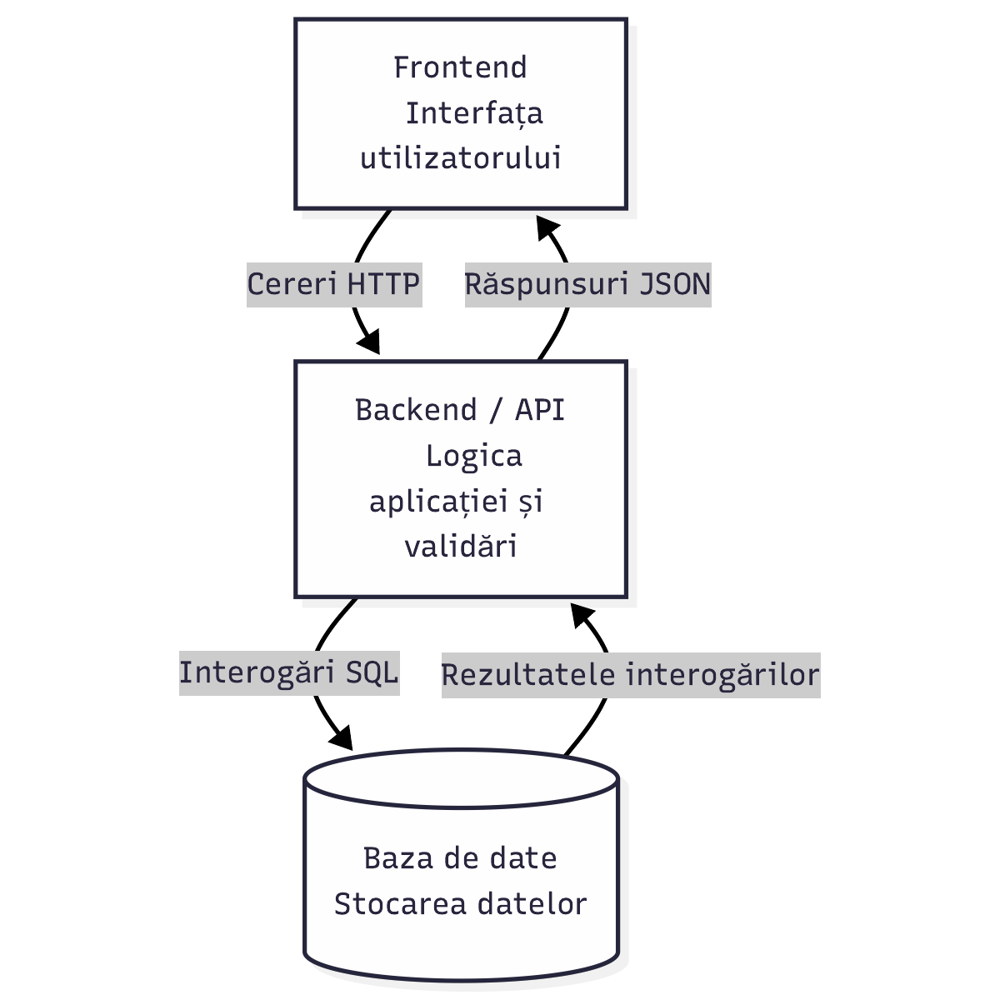

# Arhitectura aplicatiei

## Diagrama

## Componente si comunicare

| Componenta | Tehnologie | Responsabilitate |
|---|---|---|
| Frontend | Angular / TypeScript | Pagini, formulare, navigare, afisarea rezultatelor si cereri catre API. |
| Backend | FastAPI / Python | Autentificare, autorizare, validare, reguli de business si acces la date. |
| Persistenta | PostgreSQL | Utilizatori, organizatii, activitati, inscrieri si prezenta. |

Angular comunica cu FastAPI prin HTTP, cu date JSON pentru operatiile obisnuite. Operatiile protejate transmit tokenul de autentificare. In medii accesibile prin retea se foloseste HTTPS. Exportul returneaza un fisier CSV, iar importul transmite un CSV ca fisier.

FastAPI citeste si modifica baza de date prin interogari SQL parametrizate. Frontend-ul nu acceseaza direct baza de date. Nu sunt prevazute servicii externe obligatorii pentru prototip.

## Exemplu de flux

Cand voluntarul solicita inscrierea, Angular trimite identificatorul activitatii si tokenul. FastAPI identifica utilizatorul, verifica rolul si regulile de disponibilitate, apoi salveaza inscrierea intr-o tranzactie care previne depasirea capacitatii. API-ul raspunde cu confirmarea sau o eroare, iar interfata afiseaza rezultatul.

Ascunderea butoanelor in functie de rol imbunatateste interfata, dar autorizarea este verificata obligatoriu pe server.
