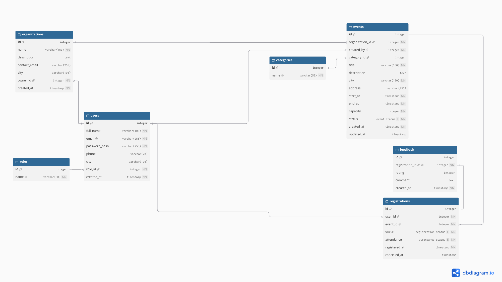

# Modelul de date si contractele API

## Model preliminar

[Diagrama DB + enumerari](assets/Diagrama_DB.pdf)

## Endpoint-uri principale

Tabelul de mai jos pastreaza rutele din documentul initial. Campurile detaliate si raspunsurile de succes sunt propuneri de contract pentru implementare, nu endpoint-uri deja functionale.

| Metoda si ruta | Acces | Intrare | Iesire si reguli |
|---|---|---|---|
| POST /api/auth/login | Public | JSON: email, password | Token si rol; 401 pentru credentiale gresite. |
| GET /api/events | Public | Query optional: city, categoryId, date | Lista activitatilor PUBLISHED cu datele principale si locurile disponibile. |
| POST /api/events | Organizer | JSON: organization_id, category_id, title, description, city, address, start_at, end_at, capacity; status propus DRAFT/PUBLISHED | Activitatea creata si id; created_by derivat din token. 400 pentru interval invalid/capacitate nepozitiva. |
| POST /api/events/{id}/registrations | Volunteer | id in ruta; utilizatorul derivat din token | Inscrierea creata; 409 pentru duplicat activ sau lipsa locurilor. |
| DELETE /api/registrations/{id} | Volunteer, propria inscriere | id in ruta | Confirmare cu status CANCELLED; 403 daca nu ii apartine. |
| PUT /api/events/{id}/attendance | Organizer, propria activitate | Lista JSON cu registrationId si attendance | Confirmare/numar actualizat; fiecare inscriere trebuie sa apartina activitatii. |
| GET /api/events/{id}/participants/export | Organizer, propria activitate | id in ruta | Fisier CSV cu participantii. |
| POST /api/events/{id}/attendance/import | Organizer, propria activitate | Fisier CSV: email, attendance | Obiect cu imported si errors, fiecare eroare avand row si message. |
| DELETE /api/admin/events/{id} | Admin | id in ruta | Confirmare; statusul activitatii devine REMOVED. |
